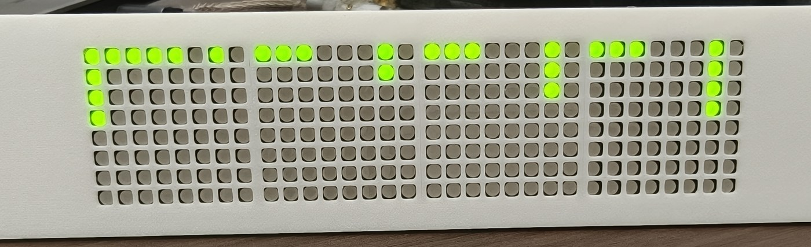
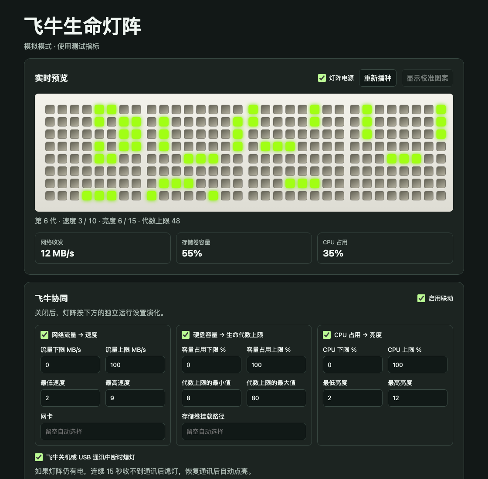
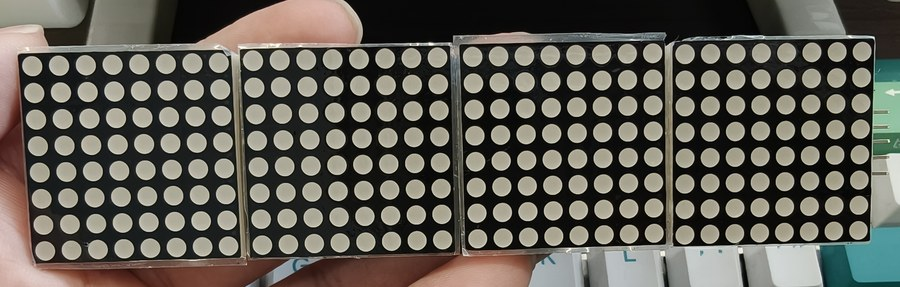
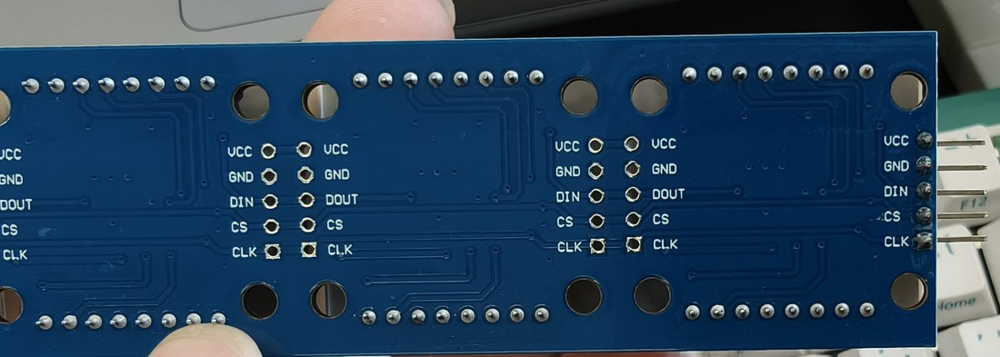

# 飞牛生命灯阵 · fnOS Life Matrix

飞牛生命灯阵是一个用 ESP32 和 MAX7219 制作的 NAS 桌面灯阵。四块 8 × 8 模块组成一块 32 × 8 屏幕，256 颗灯珠持续演化出康威生命游戏的图案。你可以把飞牛 NAS 的网络流量、存储卷占用率和 CPU 占用率分别映射到动画速度、图案的演化代数和亮度，也可以关闭联动，把它当作独立的桌面摆件。



*装机实拍。四块点阵模块横向排列，预览采用同样的四块 8 × 8 灯珠布局。*

## 网页控制面板



*项目自带模拟模式的截图。连接 ESP32 后，预览显示灯板回传的实际帧。*

- **实时查看**。预览按灯板正面绘制，每颗预览灯珠对应实体上的一个位置。面板显示当前代数、速度和亮度，也可以手动重新播种或关闭灯阵。
- **独立调节**。飞牛协同有总开关，网络、存储和 CPU 映射各有自己的开关。关闭总开关后，ESP32 用独立运行设置继续演化。
- **边调边看**。修改参数会即时应用。点击「保存设置」将设置写入 ESP32，点击「还原未保存设置」恢复上次保存的值。
- **校准位置**。从灯板正面与网页逐格对照固定图案，通过「每块灯板的方向」和「反转灯板排列」校对点阵方向与顺序。

## USB 连接如何工作


ESP32 运行生命游戏、驱动灯阵、保存设置，并通过串口提供网页资源和点阵帧。飞牛的 Docker 容器把浏览器请求转发给 ESP32，同时采集 NAS 的 CPU、网络和存储卷数据，沿同一根 USB 数据线送回 ESP32。手机和电脑在同一局域网内用浏览器访问飞牛即可。ESP32 无需配置 Wi-Fi 或蓝牙，电脑也无需运行后台服务。当前支持浏览器控制，米家 App 接入尚未实现。

## 飞牛联动与生命游戏

| 飞牛指标 | 控制项 | 如何设置 |
| --- | --- | --- |
| 网卡接收与发送之和（MB/s） | 动画速度，1–10 档 | 设定网速和速度的上下限。网卡留空时优先选择 IPv4 默认路由网卡。 |
| 所选存储卷的已用容量（%） | 一轮图案的最大演化代数，1–500 代 | 设定容量和代数的上下限。需要更换监控卷时，修改 Compose 的 `NAS_VOLUME`。 |
| CPU 占用率（%） | 点阵亮度，0–15 档 | 设定 CPU 占用和亮度的上下限。亮度 0 为最低档，完全关灯使用电源开关。 |

输入处于上下限之间时，固件按比例换算成输出档位。比如把 CPU 输入范围设为 20%–80%，亮度设为 2–12 档，CPU 在 50% 左右时亮度约为 7 档。低于或高于输入范围时，输出取对应的下限或上限。

灯阵上每颗灯珠代表一个细胞。每一代根据周围八个位置的活细胞数量更新。活细胞有 2 或 3 个活邻居时存活，空白位置恰有 3 个活邻居时点亮。图案灭绝、静止、进入短周期循环，或达到开启存储联动后设定的代数上限时，固件会自动重新播种。独立运行模式可以设置基础速度、亮度和初始生命组数。

开启「飞牛协同」和「飞牛关机或 USB 通讯中断时熄灯」后，如果 ESP32 仍有电，约 15 秒收不到 NAS 指标就会熄灯，通讯恢复后按当前设置显示。若 NAS 关机时同时切断 USB 电源，灯阵随供电停止而熄灭。

## 硬件与接线



准备经典 ESP32 开发板、四联 MAX7219 点阵、支持数据传输的 USB 线、稳定的 5 V 电源和三路 3.3 V 转 5 V 电平转换。固件使用 PlatformIO 的 `esp32dev` 环境。



先断电，从灯板背面找到带 **DIN** 标记的输入端，再连接以下引脚。

| 灯板输入 | ESP32 或供电端 |
| --- | --- |
| VCC | 稳定的 5 V 电源 |
| GND | ESP32 GND、电平转换器 GND 和 5 V 电源 GND 共地 |
| DIN | GPIO23（`D23`），经 3.3 V 转 5 V 电平转换 |
| CS | GPIO27（`D27`），经 3.3 V 转 5 V 电平转换 |
| CLK | GPIO18（`D18`），经 3.3 V 转 5 V 电平转换 |

MAX7219 用 5 V 供电时，输入高电平规格至少为 3.5 V。可用 5 V 供电的 **74AHCT125** 转换这三路信号。将所用通道的 `/OE` 接地，在芯片电源旁放置 100 nF 去耦电容。如果希望用一根 USB 线给整套设备供电，先确认 ESP32 板的 `VIN` 在 USB 供电时输出约 5 V，并确认供电能力足够。灯板使用独立 5 V 电源时，将两路电源共地，5 V 正极各自连接其负载。

## 烧录与部署

1. 将 ESP32 用 USB 数据线接到电脑，用 VS Code 的 PlatformIO 打开项目，在 `esp32dev` 环境执行 **Upload**。命令行可运行 `pio run -e esp32dev -t upload`。若有多个串口，附加 `--upload-port <串口路径>` 指定板子。
2. 将烧录好的 ESP32 插到飞牛。在仓库的 `docker` 目录复制 `.env.example` 为 `.env`，填写飞牛的局域网 IP、串口路径、串口所属组的数字 ID 和监测卷。串口检测及离线构建见 [Docker Compose 部署指南](docker/README.md)。
3. 在 `docker` 目录启动预构建镜像。飞牛的容器页面也可用 Compose 配置创建项目。

   ```bash
   docker compose -f compose.image.yaml up -d
   docker compose -f compose.image.yaml ps
   ```

4. 在同一局域网内访问 `http://<飞牛局域网IP>:8765`，或在飞牛 Docker 容器页面使用「快捷访问」。可在 `.env` 中修改 `NAS_PORT`。此面板面向可信局域网，访问无需登录。
5. 点击「显示校准图案」，从实体灯板正面核对每一块的方向与顺序。点击「结束校准」，再点击「保存设置」。

发布镜像为 `ghcr.io/wwwwwwjy/fnos-life-matrix:latest`，支持 Linux `amd64`。[GitHub Container Registry](https://github.com/wwwwwwjy/fnos-life-matrix/pkgs/container/fnos-life-matrix)

## 致谢与许可证

感谢 [Lajos Hankó（@lajoshanko）](https://github.com/lajoshanko) 开源 [ESPHome MAX7219 Game of Life](https://github.com/lajoshanko/esphome_max7219_game_of_life)，它是本项目将生命游戏呈现在 MAX7219 点阵上的灵感来源。本项目加入了 Arduino/PlatformIO 固件、飞牛指标联动、USB 串口控制和网页实时预览。

本项目采用 [MIT 许可证](LICENSE)，保留原项目的版权声明。
